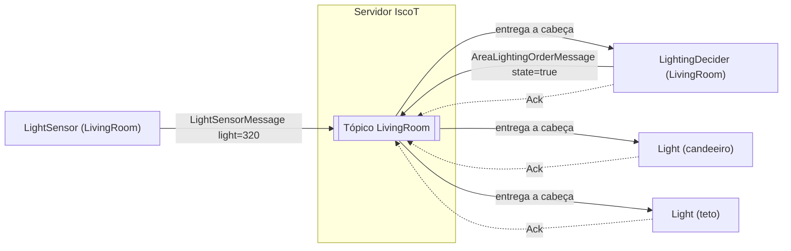
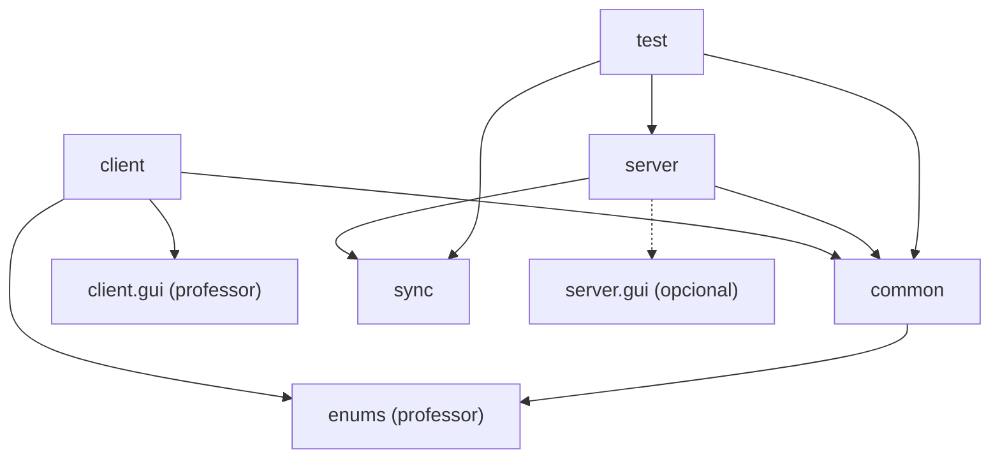
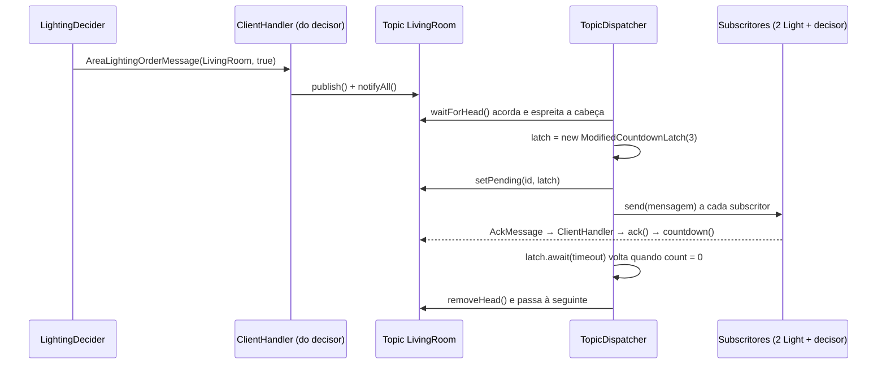
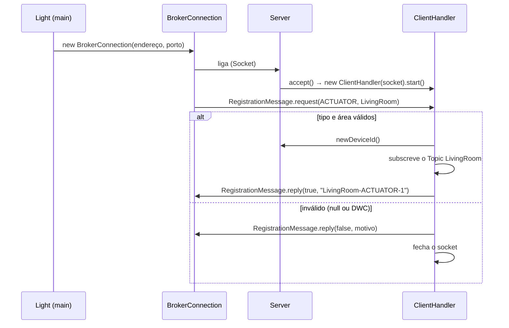

# 02 · Arquitetura do IscoT

Baseada no enunciado, na apresentação do projeto (23 out) e no **código base da GUI** dado pelo professor (`ProjetoPCD_26_27_IscoT_GUI`, 3 nov).

## Visão geral

Cenário da apresentação do professor: na sala (`LivingRoom`), 1 sensor de iluminação, 1 decisor que acende as luzes abaixo de 500 lux e 2 lâmpadas (candeeiro e teto). São 4 clientes, cada um uma aplicação independente, todos ligados só ao servidor.

## Um tópico por área

O código base e a apresentação definem o registo com **dois dados: o tipo de cliente (`iscot.enums.Type`: SENSOR, DECIDER, ACTUATOR) e a área (`iscot.enums.Areas`: Kitchen, WC, LivingRoom, BedRoom, Garden)**. O enunciado diz que "um cliente publica e consome mensagens exclusivamente de um tópico".

Com essa informação, o modelo que cumpre as duas coisas é: **cada área é um tópico**.

| Tipo | No tópico da sua área… |
|---|---|
| SENSOR | só publica (leituras) |
| DECIDER | consome (leituras e ordens) e publica (ordens) |
| ACTUATOR | só consome (leituras e ordens) |

- Todas as mensagens da área passam pela mesma fila FIFO e são entregues a **todos os subscritores** da área (decisores e atuadores).
- Cada cliente **reage só às mensagens que lhe dizem respeito**, pela classe: o `LightingDecider` reage a `LightSensorMessage`; a `Light` reage a `AreaLightingOrderMessage`; o resto ignora.
- **Todos confirmam tudo** (`AckMessage`), incluindo o que ignoram. Só assim o latch chega a zero e o tópico avança.
- O cliente nunca escolhe o tópico: o servidor usa a área da mensagem (e verifica que é a área do cliente).

A alternativa (um tópico por área e grandeza, ex.: "LivingRoom/luz") obrigaria a acrescentar à `RegistrationMessage` o que cada cliente quer ouvir, o que o professor não pediu. Ver `03-decisoes.md`, D24, e a pergunta ao professor em `07-duvidas.md`.

## O que vem do professor e o que é nosso

| Pacote | De quem | Conteúdo |
|---|---|---|
| `iscot.enums` | **professor** | `Areas`, `Type`, `AirConditioningMode` |
| `iscot.client.gui` | **professor** | `ComponentState` (base dos ícones, já usa `invokeLater`), `LightIcon`, `VentilatorIcon`, `ACIcon`, `IrrigationIcon`, `SensorControl` (slider que avisa quando o utilizador o larga) |
| `iscot.client` | **professor** (exemplos com TODO) | `HumiditySensor` (molde dos sensores), `Ventilator` (molde dos atuadores) |
| `iscot.client` | nosso | os outros dispositivos (`LightSensor`, `TemperatureSensor`, `LightingDecider`, `IrrigationDecider`, `ClimateDecider`, `Light`, `Irrigation`, `AirConditioner`), `BrokerConnection`, `ActionHistory` |
| `iscot.common` | nosso | as mensagens (`Message` e filhas, `RegistrationMessage`, `AckMessage`, `ReceptionConfirmationMessage`) |
| `iscot.server` | nosso | `Server`, `ClientHandler`, `TopicManager`, `Topic`, `TopicDispatcher` |
| `iscot.server.gui` | nosso, **opcional** | `ServerMonitorFrame` |
| `iscot.sync` | nosso | `ModifiedCountdownLatch` |
| `iscot.test` | nosso | `IscotTests`; `TopicTestFrame` (**opcional**) |

**Regra:** os ficheiros do professor só se alteram nos `TODO` dos exemplos (`HumiditySensor`, `Ventilator`). Os componentes de `iscot.client.gui` e os enums usam-se como estão.

## Os dispositivos (um programa por dispositivo)

O professor mostra um `main` **por tipo de dispositivo** (`HumiditySensor`, `Ventilator`), com 3 argumentos: `endereço porto área` (ex.: `localhost 8080 LivingRoom`). O tipo de cliente não é argumento: é implícito no programa.

| Automação (enunciado 1.2) | Sensor | Decisor | Atuador(es) | Componentes do professor | Prioridade |
|---|---|---|---|---|---|
| luz baixa → acender (cenário do professor) | `LightSensor` | `LightingDecider` (< 500 lux) | `Light` | `SensorControl`, `LightIcon` | **1 · obrigatória** |
| terra seca → regar até ao nível | `HumiditySensor` (professor) | `IrrigationDecider` | `Irrigation` | `SensorControl`, `IrrigationIcon` | 2 |
| temperatura alta → arrefecer | `TemperatureSensor` | `ClimateDecider` | `Ventilator` (professor), `AirConditioner` | `SensorControl`, `VentilatorIcon`, `ACIcon` | 3 |
| chuva → fechar janelas | — | — | — | **nenhum** no código base | não fazemos (a menos que o professor peça) |

O enunciado dá estes exemplos e acrescenta "outros comportamentos que sejam pertinentes". Não diz quantos são obrigatórios: perguntar. Fazemos a 1 primeiro, completa de ponta a ponta; as outras são cópias do mesmo padrão.

## Mensagens (formato do professor)

| Classe | Quem envia | `getType()` | Quem reage |
|---|---|---|---|
| `RegistrationMessage` | cliente (pedido) / servidor (resposta) | — | servidor / cliente |
| `LightSensorMessage` (light) | `LightSensor` | SENSOR | `LightingDecider` |
| `HumiditySensorMessage` (humidity) | `HumiditySensor` | SENSOR | `IrrigationDecider` |
| `TemperatureSensorMessage` (temperature) | `TemperatureSensor` | SENSOR | `ClimateDecider` |
| `AreaLightingOrderMessage` (state) | `LightingDecider` | DECIDER | `Light` |
| `AreaIrrigationOrderMessage` (state) | `IrrigationDecider` | DECIDER | `Irrigation` |
| `AreaClimateOrderMessage` (mode: `AirConditioningMode`) | `ClimateDecider` | DECIDER | `Ventilator`, `AirConditioner` |
| `AckMessage` (messageId) | decisores e atuadores | — | servidor (latch) |
| `ReceptionConfirmationMessage` (extra) | atuadores | ACTUATOR | servidor |

Formato do `toString`, como na apresentação: `LightSensorMessage [light=320.0, area=LivingRoom, getType()=SENSOR]`.

## Dependências entre pacotes

- `server` nunca usa `client`, e vice-versa: só se falam por mensagens do `common`.
- `common` e `enums` são o "contrato" partilhado pelos dois lados.

## Classe a classe: quem liga a quem

| Classe | O que cumpre do enunciado | Usa | É usada por |
|---|---|---|---|
| `Server` | servidor central, ligação inicial, id único | `TopicManager`, `ClientHandler` | `ClientHandler` |
| `ClientHandler` | "thread dedicada por cliente", registo, recusa | `Server`, `Topic`, mensagens | `Server` (cria), `TopicDispatcher` (send) |
| `TopicManager` | um tópico por área | `Topic`, `TopicDispatcher` | `ClientHandler` |
| `Topic` | fila FIFO, ciclo de vida da mensagem | `Message`, latch | `ClientHandler`, `TopicDispatcher`, testes |
| `TopicDispatcher` | "avança quando a cabeça é consumida" | `Topic`, latch, `ClientHandler` | `TopicManager` |
| `ModifiedCountdownLatch` | registar o consumo de cada cliente | — | `TopicDispatcher`, `Topic` |
| `BrokerConnection` | os TODO "connect" e "register" do professor | mensagens | todos os dispositivos |
| `ActionHistory` | histórico "Lâmpada desligada - HH:MM:SS" | Swing | os 4 atuadores |
| dispositivos | sensores, decisores, atuadores | `BrokerConnection`, componentes do professor | — (cada um tem `main`) |

## Ciclo de vida de uma mensagem

## Registo de um cliente

## Mapa de threads

| Thread | Onde | Quantas | Faz | Bloqueia em |
|---|---|---|---|---|
| main do servidor | `Server` | 1 | aceita ligações | `accept()` |
| `ClientHandler` | servidor | 1 por cliente | registo; lê mensagens | `readObject()` |
| `TopicDispatcher` | servidor | 1 por área com clientes | entrega a cabeça, espera os acks, avança | `waitForHead()`, `latch.await()` |
| main do dispositivo | cada cliente | 1 | liga, regista, abre a janela | — |
| recetora | decisores e atuadores (`BrokerConnection`) | 1 | lê mensagens, reage, envia ack | `readObject()` |
| EDT (Swing) | cada cliente com janela | 1 | desenha; corre o callback do `SensorControl` | fila de eventos |

No cenário do professor (4 clientes na LivingRoom): servidor com 1 main + 4 `ClientHandler` + 1 `TopicDispatcher` = 6 threads.

## Recursos partilhados e como são protegidos

| Recurso | Quem lhe toca | Proteção |
|---|---|---|
| fila e subscritores de um `Topic` | vários `ClientHandler` + 1 `TopicDispatcher` | `synchronized` + `wait/notifyAll` |
| mapa do `TopicManager` | `ClientHandler` no registo | `synchronized get` |
| contador de ids (`Server`) | `ClientHandler` | `synchronized newDeviceId` |
| `ModifiedCountdownLatch` | 1 dispatcher + N handlers | `synchronized` + `wait(ms)/notifyAll` |
| stream de saída de um cliente (servidor) | o seu `ClientHandler` + o dispatcher | `synchronized send` |
| stream de saída (cliente) | recetora + EDT | `synchronized send` |
| componentes Swing | EDT + recetora | `invokeLater` (o `ComponentState` do professor já o faz em `setAtivo`) |
| lista do `ActionHistory` | recetora (escreve) + EDT (desenha) | `invokeLater` no `add` |

**Ordem dos cadeados:** `Topic` → latch, nunca ao contrário. E nunca se envia para a rede nem se espera o latch com o cadeado de um `Topic` seguro.

## Armadilhas conhecidas

| Sintoma | Causa | Solução |
|---|---|---|
| Cliente e servidor parados ao ligar | os dois criaram primeiro o `ObjectInputStream` | Output + `flush()` primeiro |
| Versão antiga de um objeto do outro lado | cache do `ObjectOutputStream` | `reset()` depois de cada envio |
| `NotSerializableException` | campo não serializável numa mensagem | só dados simples e enums |
| `IllegalArgumentException: No enum constant iscot.enums.Areas.sala` | área escrita mal nos argumentos | usar os nomes exatos do professor: `LivingRoom`, `Garden`, … |
| "Invalid arguments!" | não foram 3 argumentos | `endereço porto área` |
| Tópico preso até ao timeout em cada mensagem | um subscritor não confirma as mensagens que ignora | confirmar **tudo** |
| `BindException` | servidor anterior ainda a correr | parar todas as consolas |
| Janela congela | trabalho bloqueante num listener | thread própria |

## Fases e onde ficam

| Fase | Enunciado | Classes |
|---|---|---|
| 1 | GUI: usar os componentes dados | atuadores com ordem criada localmente (`Light`, `Ventilator`…), sensores com `SensorControl`, `ActionHistory` |
| 2 | estrutura de tópicos | mensagens do `common`, `Topic`, `TopicManager`, `IscotTests` (grupo 1) |
| 3 | servidor e ligação inicial | `Server`, `ClientHandler` (registo), `BrokerConnection.register`, `RegistrationMessage` |
| 4 | troca de mensagens | `BrokerConnection.send/startReceiving`, ciclo do `ClientHandler`, `AckMessage`, decisores |
| 5 | CountDownLatch | `ModifiedCountdownLatch`, `TopicDispatcher`, `IscotTests` (grupos 2 e 3) |
| 6 (extra) | confirmações de execução | `ReceptionConfirmationMessage` |
| opcional | GUI do servidor, formulário | `ServerMonitorFrame`, `TopicTestFrame` |
