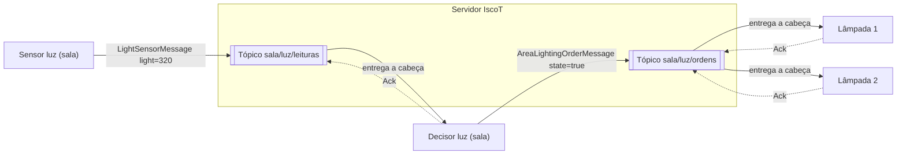
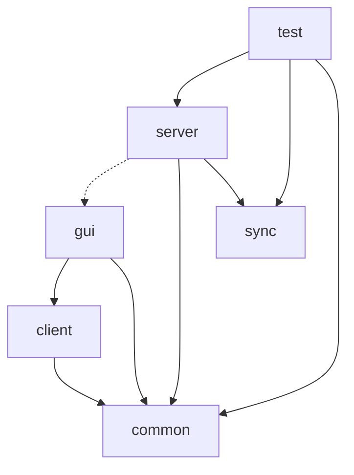
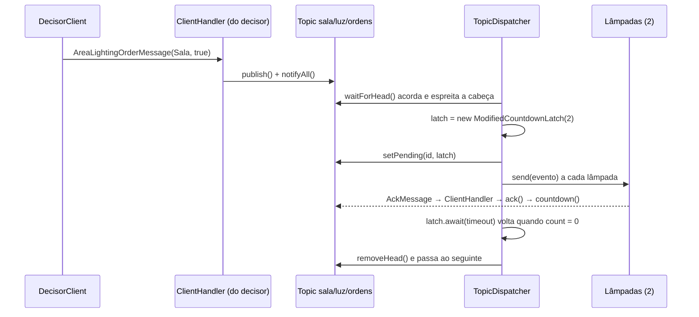
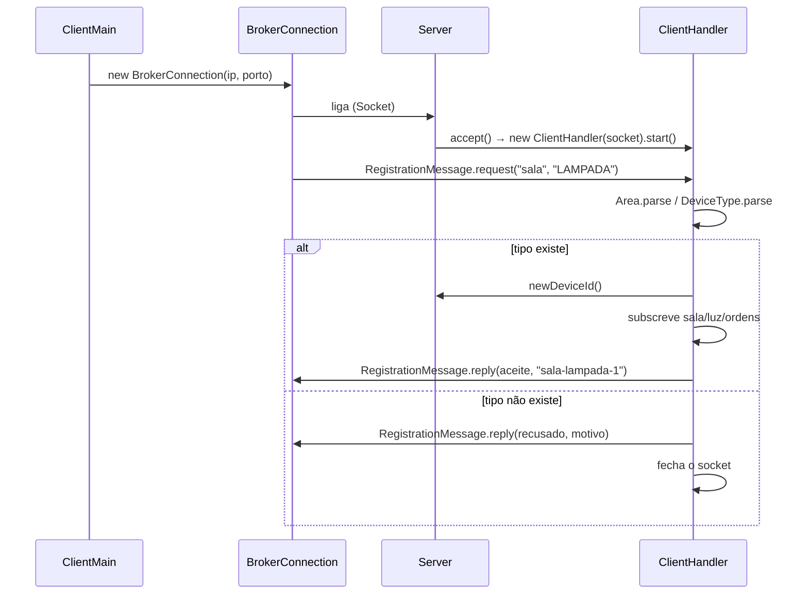

# 02 · Arquitetura do IscoT

## Visão geral

Exemplo concreto: a luz da sala. O sensor publica leituras em `sala/luz/leituras`; o decisor de luz subscreve esse tópico e publica ordens em `sala/luz/ordens`; as lâmpadas da sala subscrevem as ordens.



## Pacotes e responsabilidades

| Pacote | Para quê | Classes |
|---|---|---|
| `iscot.common` | tudo o que servidor e clientes partilham: tipos e mensagens | `Area`, `DeviceType` (com `Role` e nomes dos tópicos), `Message` e filhas |
| `iscot.sync` | mecanismos de coordenação escritos por nós (exigência do enunciado) | `ModifiedCountdownLatch` |
| `iscot.server` | o broker | `Server`, `ClientHandler`, `TopicManager`, `Topic`, `TopicDispatcher` |
| `iscot.client` | lógica dos clientes, sem Swing | `ClientMain`, `BrokerConnection`, `SensorClient`, `DecisorClient`, `ActuatorClient` (com o histórico) |
| `iscot.gui` | janelas, sem rede | `TopicTestFrame`, `SensorFrame`, `DecisorFrame`, `ActuatorFrame`, `ServerMonitorFrame` (opcional) |
| `iscot.test` | testes que se correm como programas | `IscotTests` |

**Regra de dependências** (quem pode usar quem):



- `common` não depende de ninguém: é o "contrato" entre servidor e clientes.
- `server` **nunca** usa `client` nem `gui`, e vice-versa. Só se falam por mensagens.
- Exceções conscientes: o `TopicTestFrame` (fase 2) usa `server.Topic` diretamente, porque nessa fase ainda não há rede; e o `Server` abre a `ServerMonitorFrame` (GUI opcional do servidor, sugerida pelo professor), que só recebe texto para mostrar.

## Mensagens (formato do professor)

A apresentação do projeto define as mensagens com classes próprias, cada uma com a área e o tipo de quem a envia:

```text
LightSensorMessage [light=320.0, area=Sala, getType()=SENSOR]
AreaLightingOrderMessage [state=true, area=Sala, getType()=DECIDER]
```

| Classe | Quem envia | getType() | Tópico onde o servidor a põe |
|---|---|---|---|
| `RegistrationMessage` | cliente (pedido) / servidor (resposta) | — | nenhum: é o registo |
| `LightSensorMessage` | sensor de luz | `SENSOR` | `<area>/luz/leituras` |
| `TemperatureSensorMessage` | sensor de temperatura | `SENSOR` | `<area>/temperatura/leituras` |
| `AreaLightingOrderMessage` | decisor de luz | `DECIDER` | `<area>/luz/ordens` |
| `AreaClimateOrderMessage` | decisor de clima | `DECIDER` | `<area>/temperatura/ordens` |
| `AckMessage` | decisor ou atuador | — | nenhum: faz descer o latch do tópico subscrito |
| `ReceptionConfirmationMessage` (extra) | atuador | `ACTUATOR` | nenhum |

**O cliente nunca escreve o nome do tópico.** Envia uma mensagem tipada; o servidor calcula o tópico a partir da área e da grandeza da mensagem, e verifica que quem envia tem o papel certo (só sensores enviam leituras, só decisores enviam ordens). É o que a apresentação quer dizer com "cada cliente apenas conhece o servidor a que se liga". Os tópicos são uma organização interna do servidor.

Humidade/rega e chuva/janelas seguem o mesmo padrão e entram quando fizermos essas automações.

## Classe a classe: quem liga a quem

| Classe | Objetivo do enunciado que cumpre | Usa | É usada por |
|---|---|---|---|
| `Server` | servidor central, ligação inicial, id único | `TopicManager`, `ClientHandler` | `ClientHandler` |
| `ClientHandler` | "thread dedicada por cliente", registo, recusa de tipo | `Server`, `Topic`, `DeviceType`, mensagens | `Server` (cria), `TopicDispatcher` (send) |
| `TopicManager` | gerir os tópicos e as suas filas | `Topic`, `TopicDispatcher` | `ClientHandler` |
| `Topic` | fila por tópico, ciclo de vida do evento | `Message`, `ModifiedCountdownLatch` | `ClientHandler`, `TopicDispatcher`, `TopicTestFrame` |
| `TopicDispatcher` | "avança para o próximo evento quando o da cabeça é consumido" | `Topic`, latch, `ClientHandler` | `TopicManager` (cria) |
| `ModifiedCountdownLatch` | registar o consumo por cada cliente | — | `TopicDispatcher`, `Topic` |
| `ClientMain` | argumentos do main, ligação automática | `BrokerConnection`, clientes | — (ponto de entrada) |
| `BrokerConnection` | canais de objetos do lado do cliente | mensagens | os 3 clientes |
| `SensorClient` | leituras em intervalos arbitrários | `BrokerConnection`, `SensorFrame` | `ClientMain` |
| `DecisorClient` | ordens de alto nível a partir das leituras | `BrokerConnection`, `DecisorFrame` | `ClientMain` |
| `ActuatorClient` | mudar o estado do dispositivo e manter o histórico "Lâmpada desligada - HH:MM:SS" | `BrokerConnection`, `ActuatorFrame` | `ClientMain` |
| `*Frame` | demonstrar as automações via GUI | — | os clientes |

## Ciclo de vida de um evento



## Registo de um cliente



## Mapa de threads

Pergunta típica da oral: "quantas threads tem o vosso sistema e onde é que cada uma bloqueia?"

| Thread | Onde | Quantas | Faz | Bloqueia em |
|---|---|---|---|---|
| main do servidor | `Server` | 1 | aceita ligações | `accept()` |
| `ClientHandler` | servidor | 1 por cliente | registo; lê `SensorMessage`/`OrderMessage` e `AckMessage` | `readObject()` |
| `TopicDispatcher` | servidor | 1 por tópico | entrega a cabeça, espera os acks, avança | `waitForHead()`, `latch.await()` |
| main do cliente | `ClientMain` | 1 por cliente | liga, regista, abre a janela | — |
| recetora | decisor, atuador | 1 | lê eventos, reage, envia ack | `readObject()` |
| sensor automático | sensor | 0 ou 1 | publica a intervalos | `sleep()` |
| EDT (Swing) | cada cliente com janela | 1 | desenha e corre os listeners | fila de eventos do Swing |

## Recursos partilhados e como são protegidos

| Recurso | Quem lhe toca | Proteção |
|---|---|---|
| fila e subscritores de um `Topic` | vários `ClientHandler` + 1 `TopicDispatcher` | `synchronized` + `wait/notifyAll` no `Topic` |
| mapa do `TopicManager` | vários `ClientHandler` no registo | `synchronized getOrCreate` |
| contador de ids (`Server`) | vários `ClientHandler` | `synchronized newDeviceId` |
| `ModifiedCountdownLatch` | 1 dispatcher (espera) + N handlers (descontam) | `synchronized` + `wait(ms)/notifyAll` |
| stream de saída de um cliente (servidor) | o seu `ClientHandler` + dispatchers | `synchronized send` |
| stream de saída (cliente) | thread recetora + EDT + sensor automático | `synchronized send` |
| componentes Swing | EDT + recetora | só a EDT lhes toca (`invokeLater`) |
| histórico do `ActuatorClient` | recetora (+ EDT) | `synchronized` ou confinado à EDT |

**Ordem dos cadeados** (para não haver deadlock): quando é preciso segurar dois, a ordem é sempre `Topic` → `ModifiedCountdownLatch`. Ninguém segura o latch e depois pede o `Topic`. E nunca se escreve para a rede nem se espera um latch com o cadeado de um `Topic` seguro (por isso existe o `subscribersSnapshot`).

## Armadilhas conhecidas

| Sintoma | Causa | Solução |
|---|---|---|
| Cliente e servidor parados ao ligar, sem erro | os dois criaram primeiro o `ObjectInputStream` | Output + `flush()` primeiro, nos dois lados |
| O outro lado recebe uma versão antiga de um objeto | cache do `ObjectOutputStream` | `reset()` depois de cada envio |
| `NotSerializableException` | campo não serializável numa mensagem | só dados simples nas mensagens |
| `InvalidClassException` | `serialVersionUID` diferente ou classe alterada só de um lado | recompilar tudo; mensagens só em `common` |
| `IllegalMonitorStateException` | `wait/notify` fora de `synchronized` | dentro de método ou bloco sincronizado |
| `BindException` | servidor anterior ainda a correr | parar todas as consolas no Eclipse |
| Servidor atende um cliente de cada vez | `run()` em vez de `start()` | `start()` |
| Janela congela | operação bloqueante num `actionPerformed` | thread própria |
| GUI com comportamentos estranhos de vez em quando | componentes alterados fora da EDT | `SwingUtilities.invokeLater` |
| Tópico preso | subscritor caído sem timeout | `await` com tempo + `unsubscribe` no `finally` |

## Fases do enunciado e onde ficam

| Fase | Enunciado | Classes |
|---|---|---|
| 1 | GUI | `gui/*`, histórico do `ActuatorClient` |
| 2 | estrutura de tópicos | `Area`, `DeviceType`, `Message`, `SensorMessage`, `OrderMessage` e filhas, `Topic`, `TopicManager`, `TopicTestFrame`, `IscotTests` (grupo 1) |
| 3 | servidor e ligação inicial | `Server`, `ClientHandler` (registo), `ClientMain`, `BrokerConnection`, `RegistrationMessage`, `ServerMonitorFrame` (opcional) |
| 4 | troca de mensagens | `Message`, `AckMessage`, ciclo do `ClientHandler`, os 3 clientes |
| 5 | CountDownLatch | `ModifiedCountdownLatch`, `TopicDispatcher`, `IscotTests` (grupos 2 e 3) |
| 6 (extra) | confirmações de execução | `ReceptionConfirmationMessage` |
