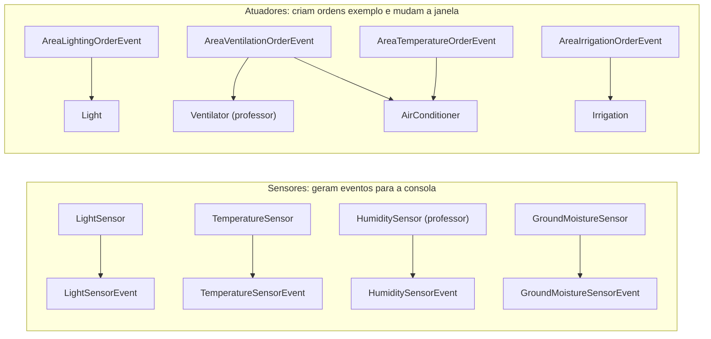
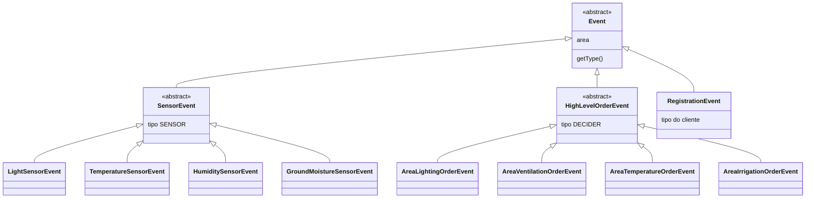
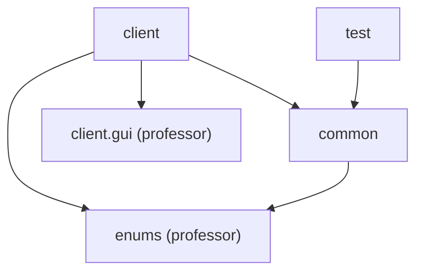
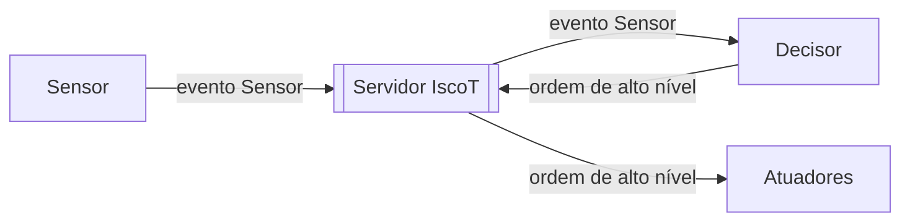

# 02 · Arquitetura

Baseada no **enunciado versão 4 (2 nov 2026)**, nos slides do projeto (23 out) e no **código base da GUI**. Em caso de diferença, prevalece o enunciado, por ser o mais recente.

## O que existe nesta entrega

São programas independentes e locais, sem servidor. Cada um mostra uma parte do sistema final.

## Hierarquia de eventos (fase 2)

| Classe | Campo próprio | Exemplo de texto |
|---|---|---|
| `LightSensorEvent` | `light` (lux) | `LightSensorEvent [light=320.0, area=LivingRoom, getType()=SENSOR]` |
| `TemperatureSensorEvent` | `temperature` (ºC) | `TemperatureSensorEvent [temperature=27.0, area=LivingRoom, getType()=SENSOR]` |
| `HumiditySensorEvent` | `humidity` (%, ar) | `HumiditySensorEvent [humidity=72.0, area=LivingRoom, getType()=SENSOR]` |
| `GroundMoistureSensorEvent` | `moisture` (%, solo) | `GroundMoistureSensorEvent [moisture=18.0, area=Garden, getType()=SENSOR]` |
| `AreaLightingOrderEvent` | `state` | `AreaLightingOrderEvent [state=true, area=LivingRoom, getType()=DECIDER]` |
| `AreaVentilationOrderEvent` | `state` | `AreaVentilationOrderEvent [state=true, area=LivingRoom, getType()=DECIDER]` |
| `AreaTemperatureOrderEvent` | `mode` | `AreaTemperatureOrderEvent [mode=Frio, area=LivingRoom, getType()=DECIDER]` |
| `AreaIrrigationOrderEvent` | `state` | `AreaIrrigationOrderEvent [state=true, area=Garden, getType()=DECIDER]` |
| `RegistrationEvent` | tipo do cliente | `RegistrationEvent [area=LivingRoom, getType()=ACTUATOR]` |

Os nomes dos campos e dos três últimos formatos são escolhas nossas, a seguir o padrão dos slides.

## O que é do professor e o que é nosso

| Pacote | De quem | Conteúdo |
|---|---|---|
| `iscot.enums` | **professor** | `Areas`, `Type`, `AirConditioningMode` |
| `iscot.client.gui` | **professor** | `ComponentState`, `LightIcon`, `VentilatorIcon`, `ACIcon`, `IrrigationIcon`, `SensorControl` |
| `iscot.client` | **professor** (exemplos com TODO) | `HumiditySensor`, `Ventilator` |
| `iscot.client` | nosso | `LightSensor`, `TemperatureSensor`, `GroundMoistureSensor`, `Light`, `AirConditioner`, `Irrigation`, `ActionHistory` |
| `iscot.common` | nosso | a hierarquia de eventos |
| `iscot.test` | nosso | `IscotTests` |

## Dependências

## Threads que já existem (nenhuma é nossa)

| Thread | Onde | Faz |
|---|---|---|
| `main` | cada programa | cria a janela; nos atuadores, percorre as ordens exemplo |
| Thread do Swing (EDT) | cada programa com janela | desenha; corre o callback do `SensorControl` |

É por isso que `ActionHistory` e os ícones entregam o trabalho à thread do Swing. O detalhe está em [01-fundamentos](01-fundamentos.md).

## Armadilhas conhecidas

| Sintoma | Causa | O que fazer |
|---|---|---|
| `No enum constant iscot.enums.Areas.sala` | área escrita mal nos argumentos | usar os nomes exatos do enum |
| `Invalid arguments!` | não foram 3 argumentos | `endereço porto área` |
| `light=320,0` no texto | formatador a usar a língua do computador | testar num Windows em português |
| Marcas do slider não coincidem com o valor | mostram o número do passo | mínimo 0 e passo 1, ou guiar-se pela etiqueta |
| Janela congela | pausa dentro da thread do Swing | pausas só na `main` |
| Duas lâmpadas parecem uma só | todas abrem em (600, 400) | afastar as janelas |
| Histórico com o mês em vez dos minutos | `MM` em vez de `mm` | `HH:mm:ss` |

## O que vem depois da entrega intermédia

Isto ainda **não** está no código: entra quando a fase começar (ver [06-plano](06-plano.md)).

Do enunciado (1 e 1.1): sensores só publicam eventos `Sensor`; decisores consomem `Sensor` e publicam `Highlevel`; atuadores só consomem `Highlevel`; cada cliente tem uma thread dedicada no servidor; um evento só sai da fila quando todos os subscritores confirmarem, ou ao fim de um tempo pré-definido.

**Hipótese a confirmar com o professor:** um tópico é o par **(tipo de evento, área)**. A versão 4 diz que os tópicos e as áreas "já estavam resolvidos" pelos enums `Type` e `Areas`, e os atuadores subscrevem "um tópico e uma área". Isto substitui o nosso desenho anterior de um tópico só por área, no qual as lâmpadas recebiam as leituras dos sensores, algo que o enunciado agora exclui.
