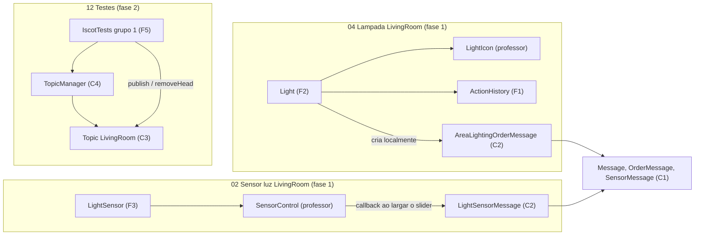

# 09 · Tarefas por pessoa e como trabalhar no GitHub

Este é o documento de trabalho do dia a dia: **que classe faz cada um, o que ela é, o que exige, quando está pronta, e em que branch se faz.** As explicações completas de cada classe estão no comentário no topo do próprio ficheiro.

## Regras de ouro

1. **Uma tarefa = uma branch = um pull request.** Uma tarefa é uma linha das tabelas abaixo (uma classe, ou um grupo pequeno de classes que só fazem sentido juntas).
2. **Ninguém faz push para a `main`.** Tudo entra por pull request, revisto pelo outro.
3. **Quem revê tem de conseguir explicar o código.** Se não consegue, pergunta no pull request antes de aprovar.
4. **Antes de começar e antes de abrir o pull request: `git pull` da `main`.**
5. **Não mexer nos ficheiros do professor** (`iscot.enums`, `iscot.client.gui`), exceto os `TODO` de `HumiditySensor` e `Ventilator`.
6. **Não fazer o que não foi pedido.** Opcionais (marcados abaixo) só depois de o obrigatório estar feito.

## Passo a passo de uma tarefa

Exemplo: o Celso vai fazer o `Topic`.

### 1. Atualizar a `main` e criar a branch
```bash
git switch main
git pull
git switch -c feature/topic
```
No Eclipse: botão direito no projeto › **Team › Pull**; depois **Team › Switch To › New Branch…**, nome `feature/topic`, com "Check out new branch" marcado.

### 2. Escrever o código
- Ler o comentário do topo da classe (diz o que implementar e porquê).
- Escrever, compilar, correr o teste correspondente.
- Pode haver vários commits na branch, pequenos:
```bash
git add src/iscot/server/Topic.java
git commit -m "Topic: fila FIFO com publish, waitForHead e removeHead"
```
No Eclipse: vista **Git Staging** (Window › Show View › Other › Git › Git Staging): arrastar o ficheiro para "Staged Changes", escrever a mensagem, **Commit**.

Mensagens de commit: `Classe: o que faz`, no presente, em português. Ex.: `LightSensorMessage: campos e toString no formato do professor`.

### 3. Enviar a branch para o GitHub
```bash
git push -u origin feature/topic
```
No Eclipse: **Commit and Push** na vista Git Staging, ou **Team › Push Branch 'feature/topic'**.

### 4. Abrir o pull request
No GitHub aparece "**Compare & pull request**". Base: `main`. Preencher:
- **Título:** o mesmo estilo dos commits.
- **Descrição:** o que faz; como testar (ex.: "correr `12 Testes`, grupo 1"); dúvidas.
- **Reviewers:** o outro.

### 5. Rever (o outro)
```bash
git fetch
git switch feature/topic
```
- Ler o código no separador **Files changed** do pull request, comentar linhas.
- Correr no Eclipse o que a descrição diz.
- Se estiver bem: **Review changes › Approve**. Se não: **Request changes** com comentários; quem fez corrige na mesma branch e faz push outra vez (o pull request atualiza-se sozinho).

### 6. Juntar à `main` (quem abriu, depois da aprovação)
- No pull request: **Merge pull request › Confirm merge › Delete branch**.
- Os dois atualizam:
```bash
git switch main
git pull
```

### Se a `main` mudou enquanto trabalhavas
```bash
git switch feature/topic
git merge main
```
Se houver conflito, o Git marca o ficheiro com `<<<<<<<`, `=======`, `>>>>>>>`. Escolher o que fica, apagar as marcas, compilar, `git add` e `git commit`. Em caso de dúvida, falar com o outro antes de resolver.

### Configurar uma vez (o Fredson, no GitHub)
- **Settings › Collaborators › Add people**: o Celso.
- **Settings › Branches › Add rule** para `main`: "Require a pull request before merging" e "Require approvals: 1".

## Tarefas por pessoa

Prioridade: **D6** = tem de estar pronto para dia 6 (fases 1 e 2) · **F3/F4/F5** = fase do enunciado · **Ext** = extra · **Opc** = opcional.

### Celso: mensagens, servidor e rega

| # | Tarefa (branch) | Classes | O que é | O que exige | Pronta quando | Prior. |
|---|---|---|---|---|---|---|
| C1 | `feature/mensagens-base` | `Message`, `SensorMessage`, `OrderMessage`, `AckMessage` | classes-mãe de tudo o que viaja pelo socket | `Serializable`, `serialVersionUID`; usar `Areas` e `Type` do professor; `messageId` não final; `getType()` | compila; as filhas conseguem estender | **D6** (primeiro: o Fredson depende disto) |
| C2 | `feature/mensagens-luz` | `LightSensorMessage`, `AreaLightingOrderMessage` | as duas mensagens do professor | `toString` exatamente `LightSensorMessage [light=320.0, area=LivingRoom, getType()=SENSOR]` | teste do formato passa | **D6** |
| C3 | `feature/topic` | `Topic` | fila FIFO de uma área + subscritores (a "mesa" da aula 04) | todos os métodos `synchronized`; `wait` em `while`; `notifyAll`; espreitar a cabeça sem remover; cópia dos subscritores | grupo 1 do `IscotTests` passa (FIFO, ids) | **D6** |
| C4 | `feature/topic-manager` | `TopicManager` | um `Topic` por área | `get(area)` `synchronized` (check-then-act) | o mesmo `Topic` para a mesma área | **D6** |
| C5 | `feature/mensagens-outras` | `HumiditySensorMessage`, `TemperatureSensorMessage`, `AreaIrrigationOrderMessage`, `AreaClimateOrderMessage` | mensagens das outras automações | mesmo padrão do C2; o clima usa `AirConditioningMode` | compilam; `toString` no formato | D6 se der tempo, senão F4 |
| C6 | `feature/registration` | `RegistrationMessage` | pedido (tipo, área) e resposta (id ou motivo) | métodos `request` e `reply`; recusar `null` e `DWC` | — | F3 |
| C7 | `feature/server` | `Server`, `ClientHandler` (parte do registo) | servidor e thread por cliente | `accept` + `start()` por cliente; streams pela ordem certa; `newDeviceId` `synchronized` | 4 clientes recebem 4 ids diferentes | F3 |
| C8 | `feature/client-handler` | `ClientHandler` (ciclo de mensagens) | publicar e receber acks | validar tipo e área de quem publica; `send` `synchronized` com `reset`; `finally` com `unsubscribe` | mensagens chegam ao tópico certo | F4 |
| C9 | `feature/rega` | `HumiditySensor` (TODO), `IrrigationDecider`, `Irrigation` | automação da rega | seguir os moldes do professor; decisor com dois limiares | humidade baixa liga a rega | F4 |
| C10 | `feature/dispatcher` | `TopicDispatcher` | entregar a cabeça a todos e esperar os acks | `setPending` antes de enviar; enviar sem cadeado; `await` com timeout | 2 lâmpadas confirmam; cliente parado → timeout | F5 |
| C11 | `feature/teste-carga` | `IscotTests` grupo 3 | 10 threads × 1000 publicações | `join` antes de verificar | 10 000 mensagens, ids únicos | F5 |

### Fredson: dispositivos, GUI e clima

| # | Tarefa (branch) | Classes | O que é | O que exige | Pronta quando | Prior. |
|---|---|---|---|---|---|---|
| F1 | `feature/action-history` | `ActionHistory` | lista de ações do atuador com hora | `JPanel` com `JList`; `add` com `invokeLater`; formato `HH:mm:ss` | mostra "Lâmpada ligada - 21:43:05" | **D6** (pode começar já, não depende de ninguém) |
| F2 | `feature/light` | `Light` (fase 1) | lâmpada, molde `Ventilator` | `LightIcon` + `ActionHistory`; ordem `AreaLightingOrderMessage` criada localmente, como o professor pede para a fase 1 | acende e apaga sozinha, com histórico | **D6** (depende de C2) |
| F3 | `feature/light-sensor` | `LightSensor` (fase 1) | sensor de luz, molde `HumiditySensor` | `SensorControl` 0–1000 lux; o callback cria e imprime a `LightSensorMessage` | mexer o slider imprime a mensagem no formato do professor | **D6** (depende de C2) |
| F4 | `feature/ventilador-fase1` | `Ventilator` (TODO da fase 1) | o exemplo do professor | ordem `AreaClimateOrderMessage` criada localmente + `ActionHistory` | liga e desliga com histórico | D6 se der tempo (depende de C5) |
| F5 | `feature/teste-estrutura` | `IscotTests` grupo 1 | testes da fase 2 | formato das mensagens, FIFO, ids, tópicos separados | todos OK | **D6** (depende de C2–C4) |
| F6 | `feature/broker-connection` | `BrokerConnection` | ligar, registar, enviar, receber, confirmar | streams pela ordem certa; `send` `synchronized`; uma thread recetora que confirma tudo | um `Light` regista-se e recebe um id | F3–F4 |
| F7 | `feature/luz-rede` | `LightSensor`, `LightingDecider`, `Light` (com rede) | cenário completo do professor | decisor: < 500 lux acende; só envia quando muda | luz baixa acende as 2 lâmpadas | F4 |
| F8 | `feature/clima` | `TemperatureSensor`, `ClimateDecider`, `Ventilator`, `AirConditioner` | automação do clima | `ACIcon.setModo` dentro de `invokeLater` | temperatura alta liga ventilador e AC | F4 |
| F9 | `feature/teste-latch` | `IscotTests` grupo 2 | testes do latch | medir tempos | timeout e libertação certos | F5 |

### Os dois

| # | Tarefa (branch) | Classes | Como | Prior. |
|---|---|---|---|---|
| A1 | `feature/latch-celso` e `feature/latch-fredson` | `ModifiedCountdownLatch` | cada um escreve a sua versão sozinho; comparam numa chamada; fica a melhor (a outra branch é apagada) | F5 |
| A2 | `feature/confirmacoes` | `ReceptionConfirmationMessage` + servidor | extra; dividir no momento | Ext |
| A3 | `feature/monitor` (Fredson) | `ServerMonitorFrame` | só no fim | Opc |
| A4 | `feature/formulario` (Fredson) | `TopicTestFrame` | só se sobrar tempo | Opc |

## Ordem até dia 6

```text
ter 3 nov (hoje)   Celso: C1 e C2, com merge ainda hoje (o Fredson precisa delas)
                   Fredson: F1 (não depende de ninguém)
qua 4 nov          Celso: C3 e C4              Fredson: F2 e F3
qui 5 nov          Celso: C5 se der            Fredson: F5 (testes); F4 se der
                   à tarde: tudo na main; cada um explica as classes do outro
                   à noite: ensaio de 5 min; git tag checkpoint-0 ; git push --tags
sex 6 nov          apresentação
```
O mínimo para dia 6 é C1–C4 + F1–F3 + F5. C5 e F4 só se sobrar tempo.

## As notas dentro de cada classe

Cada uma das nossas classes (e os dois exemplos do professor, `HumiditySensor` e `Ventilator`) tem, logo no topo do comentário, um bloco **PLANO** com o mesmo formato:

```text
PLANO
  Tarefa:       F2 · feature/light          ← o código da tarefa nestas tabelas e a branch
  Responsável:  Fredson   ·   Revisor: Celso
  Dia 6:        SIM (fase 1). Merge até qua 4 nov. ...   ← SIM / NÃO / OPCIONAL / SÓ A CLASSE
  No dia 6:     o que esta classe mostra na apresentação
  Depende de:   que tarefas têm de estar na main antes
  Liga-se a:    que classes a usam ou são usadas por ela
  Código base:  o que vem do professor ou o que mudou por causa dele
```

Por baixo do PLANO continuam as notas de sempre: o objetivo no enunciado, o que implementar, concorrência, alternativas, dúvidas e como testar. Antes de começar uma tarefa, ler a classe inteira.

**Classes que entram no dia 6:** `Message`, `SensorMessage`, `OrderMessage`, `AckMessage` (só compilar), `LightSensorMessage`, `AreaLightingOrderMessage`, `Topic`, `TopicManager`, `ActionHistory`, `Light`, `LightSensor`, `IscotTests` (grupo 1). **Opcionais no dia 6:** as outras mensagens (C5) e a fase 1 do `Ventilator` (F4). Todas as outras dizem `Dia 6: NÃO`.

## Os ficheiros do professor: o que são e como os usamos

Estes ficheiros **não têm notas nossas e não se alteram** (são o código base que o professor vai reconhecer). Exceção: `HumiditySensor` e `Ventilator`, que são exemplos com `TODO` para completarmos.

| Ficheiro | O que é | Como o usamos | Atenção |
|---|---|---|---|
| `enums/Areas` | as 5 áreas: `Kitchen, WC, LivingRoom, BedRoom, Garden` | campo `area` de todas as mensagens; chave dos tópicos; 3.º argumento de todos os programas | escreve-se exatamente assim nos argumentos (`LivingRoom`, não `sala`) |
| `enums/Type` | `SENSOR, DECIDER, ACTUATOR, DWC` | `getType()` das mensagens; tipo na `RegistrationMessage` | `DWC` "pode ser ignorado": o servidor recusa-o |
| `enums/AirConditioningMode` | `Ventilação, Frio, Aquecimento, Desligado` | campo `mode` da `AreaClimateOrderMessage` | — |
| `client/gui/ComponentState` | base de todos os ícones: `setAtivo` / `isAtivo` | não se usa diretamente | `setAtivo` já usa `invokeLater`: pode ser chamado de qualquer thread |
| `client/gui/LightIcon` | lâmpada: `setLigada(boolean)` | `Light` | intensidade: não usamos |
| `client/gui/VentilatorIcon` | ventilador: `setLigado(boolean)` | `Ventilator` | — |
| `client/gui/ACIcon` | ar condicionado: `setModo(AirConditioningMode)` | `AirConditioner` | `setModo` muda um campo fora do `invokeLater`; temperatura: não usamos |
| `client/gui/IrrigationIcon` | rega: `setAtiva(boolean)` | `Irrigation` | zona e duração: não usamos |
| `client/gui/SensorControl` | slider com nome, unidade, mínimo, máximo, passo, valor inicial e um callback | `LightSensor`, `HumiditySensor`, `TemperatureSensor` | o callback só é chamado quando o utilizador **larga** o slider, e corre na thread do Swing |
| `client/HumiditySensor` | exemplo de sensor, com `TODO` | molde dos sensores; completamos os `TODO` na tarefa C9 | tem um `import` de `LightIcon` que não usa |
| `client/Ventilator` | exemplo de atuador, com `TODO` (incluindo o da fase 1) | molde dos atuadores; completamos os `TODO` em F4 e F8 | tirar o `Thread.sleep(5000)` de demonstração quando a fase 1 estiver feita |

## Como as peças do dia 6 se ligam

Nada disto usa rede nem threads nossas. São três programas que se correm em separado no Eclipse.



O que liga tudo é o pacote `common`: as mensagens do Celso (C1 e C2) são usadas pela lâmpada e pelo sensor do Fredson e pelos testes. Por isso **C1 e C2 têm de entrar na `main` primeiro**, hoje.

## O que mostrar no dia 6 com estas tarefas

1. `04 Lampada LivingRoom` (duas vezes): a lâmpada acende e apaga com uma ordem criada localmente, e o histórico mostra `Lâmpada ligada - HH:MM:SS`. É exatamente o que o professor pede no `TODO` da fase 1.
2. `02 Sensor luz LivingRoom`: mexer o slider imprime `LightSensorMessage [light=320.0, area=LivingRoom, getType()=SENSOR]`.
3. `12 Testes`: mensagens a entrar nas filas da área, por ordem, com ids; "consumir a cabeça" tira a mais antiga.
4. O diagrama de `docs/02-arquitetura.md`, para explicar o que vem a seguir.
