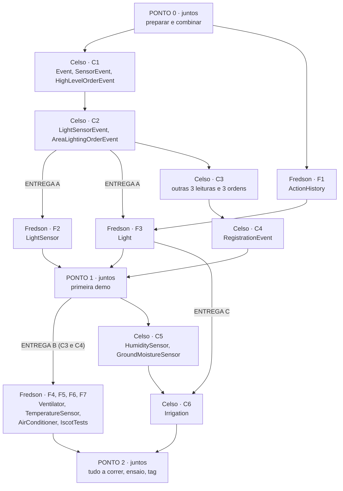

# 09 · Roteiro de trabalho, tarefas e GitHub

O documento de trabalho do dia a dia: **por onde cada um começa, o que tem de entregar ao outro, o que se faz em separado e o que se faz em conjunto.** Os passos de cada classe estão no comentário no topo dela. **Ler a classe inteira antes de começar.**

## Resumo: por onde começar

| | Primeira classe | Depois | O que espera do outro |
|---|---|---|---|
| **Celso** | `Event` | os outros eventos, depois humidade e rega | só a `Light` e o `ActionHistory`, para a `Irrigation` |
| **Fredson** | `ActionHistory` | sensores e atuadores | os eventos-modelo, e depois os restantes |

## O roteiro, etapa a etapa



### Ponto 0 · Juntos, antes de começar (sex 6 nov, cerca de 30 min)

Trabalho conjunto, numa chamada:

1. **Preparar:** clonar a `main` nos dois PCs; confirmar que o projeto compila; correr o `HumiditySensor` e o `Ventilator` do professor.
2. **Combinar os contratos**, para cada um poder escrever a sua parte sem esperar pelo outro:

| Contrato | Quem o cumpre | Quem o usa | O que têm de combinar |
|---|---|---|---|
| Criar eventos | Celso | Fredson | ordem no construtor (sugestão: primeiro a área, depois o valor) |
| Consultar eventos | Celso | Fredson | nome dos métodos de consulta (área, valor, estado, modo) |
| Texto dos eventos | Celso | Fredson (testes) | os formatos de [02-arquitetura](02-arquitetura.md) |
| Registar uma ação | Fredson | Celso | o nome do método do `ActionHistory`, que só recebe a descrição |
| Forma das janelas | os dois | os dois | ícone ao centro, histórico em baixo; copiar o molde em cada sensor, ou criar uma classe comum |
| Ordens de exemplo | os dois | os dois | que técnica usar: pausas na `main`, `Timer` ou botões (ver as notas da `Light`) |

3. **Registar** o que ficou combinado em [03-decisoes](03-decisoes.md).

### Etapa 1 · Em separado (sáb 7 nov)

| Celso | Fredson |
|---|---|
| 1. `Event` | 1. `ActionHistory` |
| 2. `SensorEvent` | Se sobrar tempo: passos 1 a 3 do `LightSensor` (não dependem de eventos) |
| 3. `HighLevelOrderEvent` → **pull request C1** | |
| 4. `LightSensorEvent` | |
| 5. `AreaLightingOrderEvent` → **pull request C2** = **ENTREGA A** | |

São trabalhos independentes: ninguém fica à espera do outro. O Fredson revê C1 e C2; o Celso revê F1.

### Etapa 2 · Em separado, depois da Entrega A (dom 8 nov)

| Celso | Fredson |
|---|---|
| 6 a 11. As outras 3 leituras e 3 ordens → **pull request C3** = **ENTREGA B** | 2. `LightSensor` → **pull request F2** |
| 12. `RegistrationEvent` → **pull request C4** | 3. `Light` → **pull request F3** = **ENTREGA C** |

### Ponto 1 · Juntos, primeira demo (dom 8 nov, à noite, cerca de 45 min)

- [ ] `git pull` da `main` nos dois PCs; compila.
- [ ] `01 Sensor luz`: o slider imprime exatamente o texto dos slides.
- [ ] `05 Lampada`, duas vezes: as lâmpadas acendem e apagam, com hora.
- [ ] **O Celso explica a `Light`, e o Fredson explica a hierarquia.**
- [ ] Rever os contratos: algo teve de mudar? O que aprendemos que afeta a Etapa 3?

Se isto falhar, corrigir antes de avançar: é o modelo de todas as outras janelas.

### Etapa 3 · Em separado (seg 9 nov)

| Celso | Fredson |
|---|---|
| 13. `HumiditySensor` | 4. `Ventilator` |
| 14. `GroundMoistureSensor` → **pull request C5** | 5. `TemperatureSensor` |
| 15. `Irrigation` → **pull request C6** | 6. `AirConditioner` |
| | 7. `IscotTests` |

### Ponto 2 · Juntos, antes da apresentação (seg 9 nov, à noite, cerca de 1 h)

- [ ] `09 Testes` todo OK. Se uma verificação falhar, corrigem em conjunto.
- [ ] Todas as caixas de [05-testes](05-testes.md), nos dois PCs.
- [ ] Cada um explica duas classes do outro.
- [ ] Ensaio cronometrado do guião de [08-apresentacao-intermedia](08-apresentacao-intermedia.md).
- [ ] Tag: `git tag entrega-intermedia` e `git push --tags`.

## As três entregas entre vocês

Uma entrega só conta quando o pull request está **na `main`** e o outro foi avisado.

| Entrega | De → para | O que entrega | Fica desbloqueado | Até |
|---|---|---|---|---|
| **A** | Celso → Fredson | C1 e C2: base e eventos-modelo | `LightSensor`, `Light` | sáb 7 |
| **B** | Celso → Fredson | C3 e C4: restantes eventos | `Ventilator`, `TemperatureSensor`, `AirConditioner`, `IscotTests` completo | dom 8 |
| **C** | Fredson → Celso | F1 e F3: `ActionHistory` e `Light` | `Irrigation` | dom 8 |

**Se uma entrega atrasar:** quem espera não fica parado. O Fredson pode fazer os passos que não precisam de eventos (janelas, ícones, histórico). O Celso pode fazer o `HumiditySensor` e o `GroundMoistureSensor`, que só dependem dos seus próprios eventos.

## Tarefas

### Celso: eventos, humidade e rega

| # | Branch | Classes, por ordem | Pronta quando |
|---|---|---|---|
| C1 | `feature/eventos-base` | `Event`, `SensorEvent`, `HighLevelOrderEvent` | compila; as filhas conseguem estender |
| C2 | `feature/eventos-modelo` | `LightSensorEvent`, `AreaLightingOrderEvent` | texto igual ao dos slides |
| C3 | `feature/eventos-restantes` | `TemperatureSensorEvent`, `HumiditySensorEvent`, `GroundMoistureSensorEvent`, `AreaVentilationOrderEvent`, `AreaTemperatureOrderEvent`, `AreaIrrigationOrderEvent` | texto no formato certo |
| C4 | `feature/evento-registo` | `RegistrationEvent` | texto no formato certo |
| C5 | `feature/sensores-humidade` | `HumiditySensor` (TODO), `GroundMoistureSensor` | o slider imprime o evento |
| C6 | `feature/irrigation` | `Irrigation` | liga e desliga, com histórico |

### Fredson: histórico, luz, ventilador, temperatura e ar condicionado

| # | Branch | Classe | Pronta quando |
|---|---|---|---|
| F1 | `feature/action-history` | `ActionHistory` | mostra `Lâmpada ligada - 21:43:05` |
| F2 | `feature/light-sensor` | `LightSensor` | o slider imprime o evento |
| F3 | `feature/light` | `Light` | acende e apaga, com histórico |
| F4 | `feature/ventilator` | `Ventilator` (TODO) | liga e desliga, com histórico |
| F5 | `feature/temperature-sensor` | `TemperatureSensor` | o slider imprime o evento |
| F6 | `feature/air-conditioner` | `AirConditioner` | ventilação ignorada em modo `Frio` |
| F7 | `feature/testes-eventos` | `IscotTests` | tudo OK |

### Outras fases

Depois da entrega intermédia: ver [06-plano](06-plano.md). A divisão será feita nessa altura.

## As notas dentro de cada classe

```text
PLANO
  Tarefa:      F3 · feature/light · FREDSON, 3.ª CLASSE A FAZER
  Revisor, Fase, Etapa
  Precisa de:  o que tem de estar pronto antes (e de quem)
  Quem espera: quem fica à espera desta classe

PASSOS (por esta ordem)
  Passo N · O que fazer
    Lógica sugerida:  como pensar o problema, sem código
    Porquê:           a razão, para estudar e saber explicar
    Liga-se a:        as outras partes do nosso código

CONCEITOS DA UC A USAR, OPÇÕES PARA COMEÇAR, ARMADILHAS, NA APRESENTAÇÃO
```

As notas dão uma lógica sugerida e **não dão o código**: é um ponto de partida para ler, estudar e perceber a ligação com o resto. Quem implementa pesquisa, escolhe e tem de saber dizer porquê. **[sugestão]** é só isso. Se a escolha afetar o outro, registar em [03-decisoes](03-decisoes.md).

## Regras de ouro

1. **Uma tarefa = uma branch = um pull request.**
2. **Ninguém faz push para a `main`.** Tudo entra por pull request, revisto pelo outro.
3. **Quem revê tem de conseguir explicar o código.** Se não consegue, pergunta no pull request antes de aprovar.
4. **Antes de começar e antes de abrir o pull request: `git pull` da `main`.**
5. **Não mexer nos ficheiros do professor** (`iscot.enums`, `iscot.client.gui`), exceto os `TODO` de `HumiditySensor` e `Ventilator`.
6. **Não fazer o que não foi pedido.** Nesta entrega não há servidor nem threads nossas.

## Passo a passo de uma tarefa

Exemplo: o Fredson vai fazer a `Light`.

### 1. Atualizar a `main` e criar a branch
```bash
git switch main
git pull
git switch -c feature/light
```
No Eclipse: botão direito no projeto › **Team › Pull**; depois **Team › Switch To › New Branch…**, nome `feature/light`, com "Check out new branch" marcado.

### 2. Escrever o código
- Ler o comentário do topo da classe.
- Escrever, compilar, correr a configuração correspondente em `launch/`.
- Pode haver vários commits na branch, pequenos:
```bash
git add src/iscot/client/Light.java
git commit -m "Light: aplica ordens exemplo ao ícone e ao histórico"
```
No Eclipse: vista **Git Staging** (Window › Show View › Other › Git › Git Staging): arrastar o ficheiro para "Staged Changes", escrever a mensagem, **Commit**.

Mensagens de commit: `Classe: o que faz`, no presente, em português.

### 3. Enviar a branch para o GitHub
```bash
git push -u origin feature/light
```
No Eclipse: **Commit and Push** na vista Git Staging, ou **Team › Push Branch 'feature/light'**.

### 4. Abrir o pull request
No GitHub aparece "**Compare & pull request**". Base: `main`. Preencher:
- **Título:** o mesmo estilo dos commits.
- **Descrição:** o que faz; como testar (ex.: "correr `05 Lampada LivingRoom`"); opção escolhida; dúvidas.
- **Reviewers:** o outro.

### 5. Rever (o outro)
```bash
git fetch
git switch feature/light
```
- Ler o código no separador **Files changed** do pull request, comentar linhas.
- Correr no Eclipse o que a descrição diz.
- Se estiver bem: **Review changes › Approve**. Se não: **Request changes** com comentários; quem fez corrige na mesma branch e faz push outra vez (o pull request atualiza-se sozinho).

### 6. Juntar à `main` (quem abriu, depois da aprovação)
- No pull request: **Merge pull request › Confirm merge › Delete branch**.
- Os dois atualizam:
```bash
git switch main
git pull
```

### Se a `main` mudou enquanto trabalhavas
```bash
git switch feature/light
git merge main
```
Se houver conflito, o Git marca o ficheiro com `<<<<<<<`, `=======`, `>>>>>>>`. Escolher o que fica, apagar as marcas, compilar, `git add` e `git commit`. Em caso de dúvida, falar com o outro antes de resolver.

### Configurar uma vez (o Fredson, no GitHub)
- **Settings › Collaborators › Add people**: o Celso.
- **Settings › Branches › Add rule** para `main`: "Require a pull request before merging" e "Require approvals: 1".

## Os ficheiros do professor: o que são e como os usamos

Os ficheiros `enums` e `client/gui` **não têm notas nossas e não se alteram**. Exceção: `HumiditySensor` e `Ventilator`, que são exemplos com `TODO`.

| Ficheiro | O que é | Como o usamos | Atenção |
|---|---|---|---|
| `enums/Areas` | as 5 áreas | campo `area` dos eventos; 3.º argumento dos programas | escreve-se exatamente assim (`LivingRoom`, não `sala`) |
| `enums/Type` | `SENSOR, DECIDER, ACTUATOR, DWC` | `getType()` dos eventos | `DWC` "pode ser ignorado" |
| `enums/AirConditioningMode` | `Ventilação, Frio, Aquecimento, Desligado` | `AreaTemperatureOrderEvent`, `AirConditioner` | — |
| `client/gui/ComponentState` | base dos ícones | não se usa diretamente | `setAtivo` usa `invokeLater`: o valor só muda depois |
| `client/gui/LightIcon` | lâmpada: `setLigada` | `Light` | — |
| `client/gui/VentilatorIcon` | ventilador: `setLigado` | `Ventilator` | — |
| `client/gui/ACIcon` | ar condicionado: `setModo` | `AirConditioner` | desenha o mesmo símbolo em todos os modos ativos |
| `client/gui/IrrigationIcon` | rega: `setAtiva` | `Irrigation` | — |
| `client/gui/SensorControl` | slider com callback | sensores | as marcas mostram o número do passo, não o valor; o callback corre na thread do Swing |
| `client/HumiditySensor` | exemplo de sensor | molde dos sensores; C5 | humidade do **ar** |
| `client/Ventilator` | exemplo de atuador | molde dos atuadores; F4 | a demonstração com `sleep` é para substituir |
